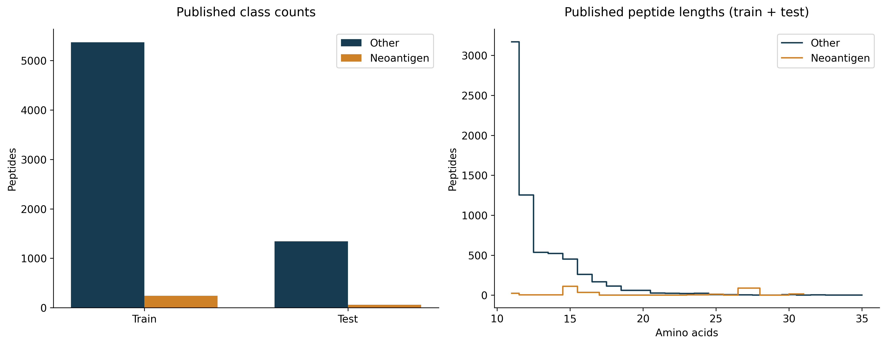
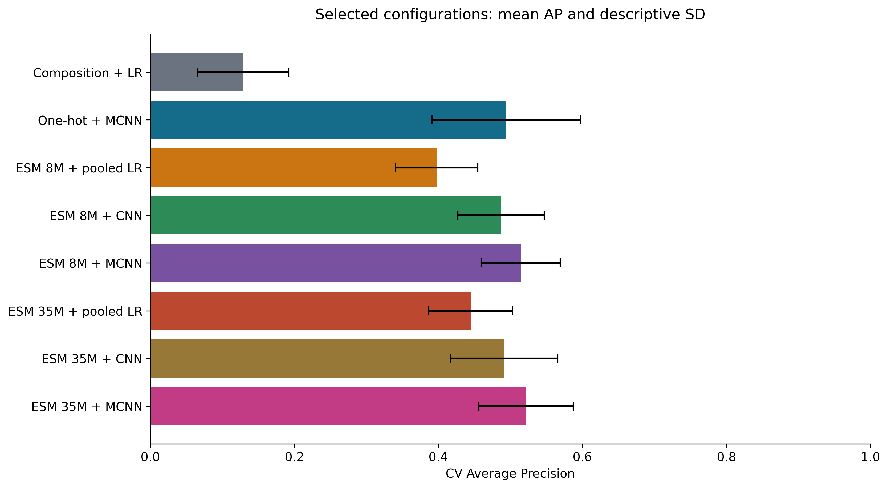
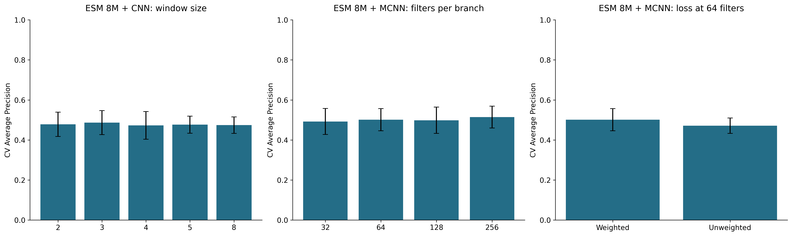
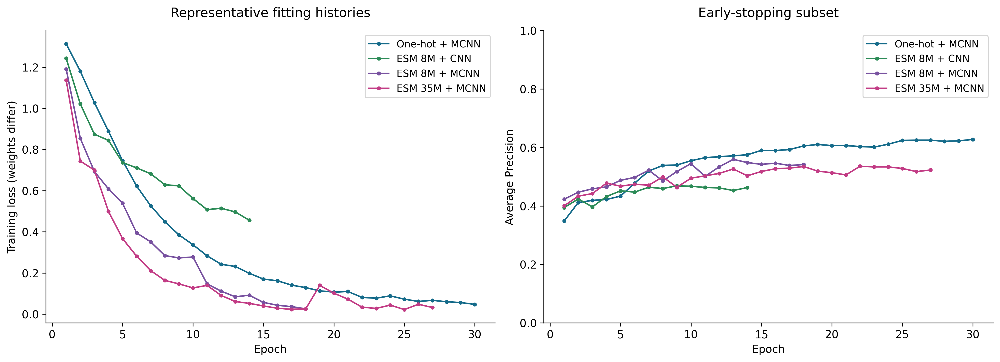
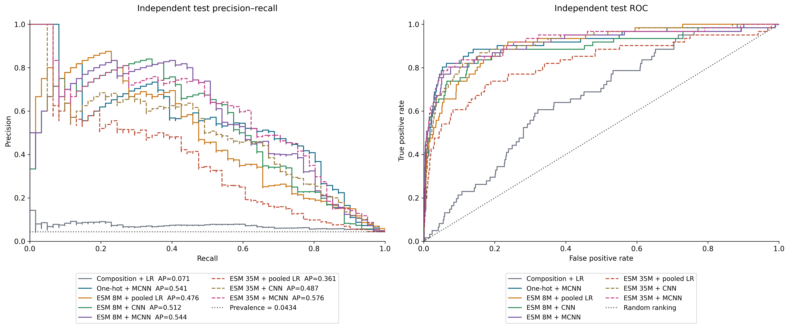
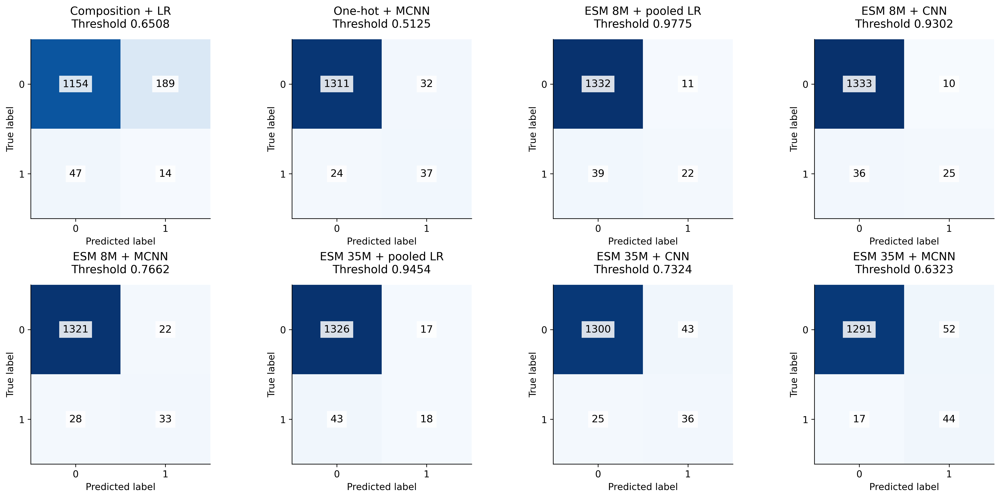

# DeepNeoAG: Full Experiment Report

**Reviewed:** 25 October 2026. **Evidence:** the supplied `results_full/` run, with 258 completed fits and eight model families. **Scope:** a course investigation of sequence-based peptide classification. This report and the presentation use English, as required by `plan.md`.

**Model names:** LR = Logistic Regression; CNN = single-window convolutional neural network; MCNN = multi-window convolutional neural network. “One-hot + MCNN” uses the multi-window architecture. ESM encoders are frozen in every model.

## Executive summary

- ESM-2 35M + MCNN (ESM 35M + MCNN) has the highest observed independent-test AP, **0.5758**, versus **0.5408** for one-hot MCNN (One-hot + MCNN) and **0.5437** for ESM-2 8M + MCNN (ESM 8M + MCNN). ESM 35M + MCNN also has the highest CV selection AP, 0.5216. It was not chosen by retuning on test results.
- The differences are uncertain. The exploratory paired 95% bootstrap interval for ESM 35M + MCNN minus One-hot + MCNN test AP is **−0.0444 to +0.1151**; for ESM 35M + MCNN minus ESM 8M + MCNN it is **−0.0522 to +0.0922**. These results do not establish superiority or equivalence. The test contains only **61 positives**.
- One-hot MCNN is a strong low-cost reference: **28,801** trainable parameters and no encoder, compared with **2,705,921** downstream trainable parameters plus a frozen 35M encoder for ESM 35M + MCNN. At OOF-selected thresholds, One-hot + MCNN/ESM 8M + MCNN/ESM 35M + MCNN MCC values are **0.5495/0.5512/0.5513**, while their precision–recall trade-offs differ.
- Numerical and file integrity checks pass, with a provenance caveat: the recorded full-run code hash differs from the current workspace source and notebook. Preserve the executed Kaggle notebook before claiming exact reproducibility. No new GPU training or post-test model tuning was performed for this report.

## 1. Research objective and experiment sequence

The task assigns label 1 to the dataset's neoantigen group and label 0 to its other-peptide group, using only an amino-acid sequence. No HLA allele, tumor context, processing assay or T-cell response is supplied as a model input. A score is a dataset classification result, not experimental evidence of immunogenicity.

The five core approaches answer successive questions: composition + Logistic Regression (Composition + LR) asks whether residue frequencies suffice; one-hot MCNN (One-hot + MCNN) learns ordered patterns directly; frozen ESM pooled + LR (ESM 8M + pooled LR) tests contextual representations; ESM single-window CNN (ESM 8M + CNN) adds local feature extraction; ESM MCNN (ESM 8M + MCNN) combines scales. ESM 35M + pooled LR/ESM 35M + CNN/ESM 35M + MCNN repeat the pooled/single/multi heads with the larger 35M encoder. These are independent models, not a prediction cascade.

## 2. Data preparation, provenance and audit

The source dataset was obtained from the author repository at commit `0bebb4ff3fa2bc9ba05e51a18771a14ac8b1c897`. The supplied published split is retained. The report uses the actual run's `train_used.csv` and `test_used.csv`, checked against the current project CSVs.

| split | Other | Neoantigen |
| --- | --- | --- |
| train | 5367 | 241 |
| test | 1343 | 61 |

There are **7,012 records** in total: 302 positives and 6,710 others. Train prevalence is **4.2974%**; test prevalence is **4.3447%**. Predicting every test record as other would already achieve **95.6553% accuracy**, but zero positive recall and MCC 0. AP and MCC therefore carry more information than accuracy alone. The reference level of an uninformative PR ranking is approximately the test prevalence, 0.0434; finite-sample random AP need not equal it exactly.

Audit checks confirm unique IDs, binary labels, a standard 20-residue alphabet, sequence/length agreement, no missing fields, no exact duplicate sequences and no exact train–test sequence overlap. Full mode retains all negatives. The full run records **7,019 verified packaged checksum entries**. That historical dataset-checksum operation is recorded by the run; the new review verifies the run manifest and compares CSV content, rather than rerunning the original archive extraction.

The 35-residue negative test record `sgh_sequence7831` is retained. Padding is to length 35, not a reason to discard this boundary case. The repository describes a final dataset after similarity filtering; its reported 30% filtering has **not** been independently reconstructed. Absence of exact duplicates does not establish homology independence. The negative group reflects source labels and may contain biologically heterogeneous peptides.



## 3. Feature processing and model construction

Composition uses 20 normalized amino-acid frequencies and balanced LR. One-hot uses residue identity channels and padded positions. ESM-2 encoders are frozen: `esm2_t6_8M_UR50D`, layer 6, D=320, and `esm2_t12_35M_UR50D`, layer 12, D=480. Cache metadata records 7,012 embeddings per encoder, float16 storage and float32 computation.

The documented implementation removes special tokens, excludes padding from mean pooling and masks convolution windows touching padding before global maximum pooling. Tensors are transposed from `[B,35,D]` to `[B,D,35]` for convolution. Each MCNN branch applies a window, activation and masked maximum; concatenated features pass through dropout and a linear classifier. Default windows are 2/3/4/5/8. Default 64 filters produce 320 concatenated values; the **selected 256-filter MCNN produces 1,280**, so default architecture illustrations must be labelled separately from the selected model.

The current implementation fits LR scalers on each outer-training partition; LR uses the complete outer-training partition because it has no early stopping. Neural fitting uses an inner split for early stopping and computes positive class weights only from fitting labels. These implementation claims describe the plan and inspected current source. Because the executed run's source hash differs, artifacts alone do not certify every internal operation of that historical source version; numerical, split and selection checks are independently supported by saved evidence.

## 4. Evaluation protocol and execution

The shared stratified five-fold split uses seed 535 on the 5,608 training records. Within each fold, neural training reserves 15% of the outer-training portion for early stopping. Outer-validation IDs are disjoint from fitting and early-stop IDs; the independent-test IDs occur in none of these partitions. Each train ID has exactly one outer-validation assignment.

LR runs once per fold; neural settings run seeds 535/536/537. AdamW uses learning rate 0.001, weight decay 0.01, batch size 64, dropout 0.3, a 30-epoch maximum and patience 5. Configuration selection maximizes mean AP over saved outer-fold/seed runs, then MCC at 0.5 within AP tolerance 1e-6, then fewer parameters and configuration ID. This is a **selection score**, not an unbiased post-selection estimate. Three seeds on one fold are correlated evaluations on the same records; 15 scores are not 15 independent datasets.

OOF predictions average neural seed probabilities per record. A second operating threshold maximizes OOF MCC, breaking ties by closeness to 0.5 and then the larger threshold. The current review independently reconstructs all eight thresholds using cumulative confusion counts. Configuration-lock log events precede all recorded final completions. Refit uses all train records, with the ceiling of the median CV best epoch. Test is evaluated at both 0.5 and the locked threshold. Neural test probabilities average three final seed models; LR's ensemble-labelled row is identical to its one fitted model.

There are **22 configurations**: 9 LR × 5 folds = 45 CV fits, 13 neural × 5 folds × 3 seeds = 195 CV fits, plus 3 LR and 15 neural final refits = **258 fits**. All planned IDs are unique and present.

The environment records a **Tesla T4**, CUDA PyTorch 2.11.0+cu128, Python 3.13.15, NumPy 2.1.3, pandas 2.3.3, scikit-learn 1.6.1 and FAIR ESM 2.0.0. The status reports 38.89 minutes; this is a status snapshot before the completion-stage archive export. Log stage endpoints span approximately **40.43 minutes**, and `stage_times.csv` sums to **40.42 minutes**. The completion stage accounts for about 92.41 seconds of the difference from the status snapshot. Do not sum status elapsed time and stage totals as independent compute costs. Training timings are hardware-specific observations.

## 5. Model selection and cross-validation results

| family | config_id | mean_ap | std_ap | trainable_parameters | threshold | refit_epochs |
| --- | --- | --- | --- | --- | --- | --- |
| Composition + LR | Composition + LR [config ace9324f90] | 0.1287 | 0.0635 | 21 | 0.6508 | 0 |
| One-hot + MCNN | One-hot + MCNN [config 24b1db6137] | 0.4943 | 0.1032 | 28801 | 0.5125 | 23 |
| ESM 8M + pooled LR | ESM 8M + pooled LR [config baec5be73e] | 0.3976 | 0.0572 | 321 | 0.9775 | 0 |
| ESM 8M + CNN | ESM 8M + CNN [config 2db43af49f] | 0.4868 | 0.0600 | 61569 | 0.9302 | 13 |
| ESM 8M + MCNN | ESM 8M + MCNN [config aca8787dd7] | 0.5142 | 0.0547 | 1804801 | 0.7662 | 16 |
| ESM 35M + pooled LR | ESM 35M + pooled LR [config 69a0c2014b] | 0.4449 | 0.0581 | 481 | 0.9454 | 0 |
| ESM 35M + CNN | ESM 35M + CNN [config 62cd8d59ce] | 0.4913 | 0.0744 | 92289 | 0.7324 | 10 |
| ESM 35M + MCNN | ESM 35M + MCNN [config 6b82f35e74] | 0.5216 | 0.0655 | 2705921 | 0.6323 | 14 |

`std_ap` is sample SD over fold/seed rows, not a confidence interval and not the SD of five seed-ensembled fold scores. One-hot + MCNN's 0.1032 spread is larger than ESM 8M + MCNN's 0.0547 and ESM 35M + MCNN's 0.0655 under this descriptive summary. Fold-averaged AP is particularly low on fold 4 for One-hot + MCNN (0.3252), ESM 8M + MCNN (0.4153), ESM 35M + CNN (0.3555) and ESM 35M + MCNN (0.3978). This pattern suggests partition sensitivity; it does not identify its biological cause.



### 5.1 Keep fixed settings separate from tuned selections

| family | config_id | mean_ap | mean_mcc | trainable_parameters |
| --- | --- | --- | --- | --- |
| Composition + LR | Composition + LR [config ace9324f90] | 0.1287 | 0.1505 | 21 |
| One-hot + MCNN | One-hot + MCNN [config 24b1db6137] | 0.4943 | 0.4182 | 28801 |
| ESM 8M + pooled LR | ESM 8M + pooled LR [config 3bd48f726e] | 0.3264 | 0.3173 | 321 |
| ESM 8M + CNN | ESM 8M + CNN [config 2db43af49f] | 0.4868 | 0.3603 | 61569 |
| ESM 8M + MCNN | ESM 8M + MCNN [config d8d0925c49] | 0.5013 | 0.4225 | 451201 |

At the fixed 64-filter MCNN setting, One-hot + MCNN AP is 0.4943 and ESM 8M + MCNN AP is 0.5013, a difference of 0.0070. The tuned ESM 8M + MCNN result, 0.5142, uses 256 filters and must not be attributed solely to replacing one-hot with ESM. Even matched filter counts do not match parameter counts because channel dimensions differ. ESM 8M + pooled LR's default C=1 gives AP 0.3264; selecting C=0.1 gives 0.3976, illustrating the importance of regularization on this small imbalanced dataset.

### 5.2 Controlled window, filter and loss experiments

| config_id | window | filters | weighted | mean_ap | std_ap | parameters |
| --- | --- | --- | --- | --- | --- | --- |
| ESM 8M + CNN [config 7c9dfe61c3] | 2 | 64 | True | 0.4782 | 0.0607 | 41089 |
| ESM 8M + CNN [config 2db43af49f] | 3 | 64 | True | 0.4868 | 0.0600 | 61569 |
| ESM 8M + CNN [config 4d7a90a5c9] | 4 | 64 | True | 0.4730 | 0.0692 | 82049 |
| ESM 8M + CNN [config 21ebacf4eb] | 5 | 64 | True | 0.4765 | 0.0427 | 102529 |
| ESM 8M + CNN [config ce262ad54e] | 8 | 64 | True | 0.4740 | 0.0413 | 163969 |
| ESM 8M + MCNN [config 4383f991e3] | multi | 32 | True | 0.4922 | 0.0651 | 225601 |
| ESM 8M + MCNN [config d8d0925c49] | multi | 64 | True | 0.5013 | 0.0551 | 451201 |
| ESM 8M + MCNN [config 212d1024af] | multi | 128 | True | 0.4985 | 0.0659 | 902401 |
| ESM 8M + MCNN [config aca8787dd7] | multi | 256 | True | 0.5142 | 0.0547 | 1804801 |
| ESM 8M + MCNN [config 6a52e2ff59] | multi | 64 | False | 0.4713 | 0.0384 | 451201 |

For single-window 8M CNN, window 3 has the highest mean AP (0.4868), but window scores span only 0.4730–0.4868 and their descriptive spreads overlap. This is a selected setting for this dataset, not evidence for a universal peptide motif length. At 64 filters, multi-window AP 0.5013 exceeds selected single-window AP 0.4868 by 0.0145, but multi-window also adds capacity.

The filter trend is non-monotonic: 32→64 improves AP 0.4922→0.5013, 128 falls to 0.4985, and 256 reaches 0.5142. At the matched 64-filter architecture, weighted loss gives AP **0.5013**, versus **0.4713** unweighted, a **0.0300** gain. Its MCC at 0.5 is lower, however: **0.4225** versus **0.4398**. Weighting helps ranking in this run without improving every operating-point metric. Neither loss should be chosen retrospectively on test performance.



### 5.3 Encoder size does not improve every head consistently

Pooled CV AP increases ESM 8M + pooled LR→ESM 35M + pooled LR from 0.3976 to 0.4449, but test AP decreases from 0.4764 to 0.3614. Single-window CV AP increases only 0.4868→0.4913, while test AP decreases 0.5122→0.4870. Multi-window CV AP increases 0.5142→0.5216 and test AP increases 0.5437→0.5758. These mixed results argue against assuming that a larger encoder is always better. Embedding dimension and downstream capacity also change from 8M to 35M.

## 6. Learning behavior and resource use

| family | min_best_epoch | median_best_epoch | max_best_epoch | refit_epochs |
| --- | --- | --- | --- | --- |
| One-hot + MCNN | 1 | 23.0000 | 30 | 23 |
| ESM 8M + CNN | 6 | 13.0000 | 30 | 13 |
| ESM 8M + MCNN | 3 | 16.0000 | 21 | 16 |
| ESM 35M + CNN | 3 | 10.0000 | 24 | 10 |
| ESM 35M + MCNN | 5 | 14.0000 | 22 | 14 |

Best epochs vary across folds/seeds; One-hot + MCNN and ESM 8M + CNN include trials whose best epoch is 30, the maximum budget. In representative first-fold/first-seed curves, training loss declines while early-stop AP plateaus or fluctuates, supporting the choice to select checkpoints by early-stop AP. A best epoch at the cap indicates that longer training could be studied in a fresh training-only experiment; it is not proof that more epochs improve independent performance. Weighted and unweighted raw loss scales are not directly comparable.



| encoder | dim | extraction_seconds | encoder_parameters | session_load_seconds | cache_bytes |
| --- | --- | --- | --- | --- | --- |
| 8M | 320 | 9.5309 | 7512474 | 10.4049 | 54481003 |
| 35M | 480 | 13.2104 | 33501394 | 14.4945 | 81585605 |

Encoder extraction is 9.53 s for 8M and 13.21 s for 35M in the saved cost table; cache sizes are approximately 54.5 MB and 81.6 MB (decimal). Separate session load timings are also recorded. Cached or session-dependent timings must not be generalized as end-to-end deployment latency. Mean selected downstream CV fit times are One-hot + MCNN 10.26 s, ESM 8M + MCNN 11.50 s and ESM 35M + MCNN 13.52 s per fold/seed; neural ensemble refits require three models. One-hot + MCNN has no embedding extraction cost and is a useful efficiency reference. Runtime itself need not grow monotonically with model size because early stopping changes the number of epochs.

## 7. Independent test results

### 7.1 Locked OOF-selected thresholds

| family | ap | roc_auc | mcc | precision | recall | specificity | f1 | accuracy | balanced_accuracy | threshold |
| --- | --- | --- | --- | --- | --- | --- | --- | --- | --- | --- |
| Composition + LR | 0.0714 | 0.6625 | 0.0515 | 0.0690 | 0.2295 | 0.8593 | 0.1061 | 0.8319 | 0.5444 | 0.6508 |
| One-hot + MCNN | 0.5408 | 0.9179 | 0.5495 | 0.5362 | 0.6066 | 0.9762 | 0.5692 | 0.9601 | 0.7914 | 0.5125 |
| ESM 8M + pooled LR | 0.4764 | 0.9077 | 0.4743 | 0.6667 | 0.3607 | 0.9918 | 0.4681 | 0.9644 | 0.6762 | 0.9775 |
| ESM 8M + CNN | 0.5122 | 0.8880 | 0.5262 | 0.7143 | 0.4098 | 0.9926 | 0.5208 | 0.9672 | 0.7012 | 0.9302 |
| ESM 8M + MCNN | 0.5437 | 0.9108 | 0.5512 | 0.6000 | 0.5410 | 0.9836 | 0.5690 | 0.9644 | 0.7623 | 0.7662 |
| ESM 35M + pooled LR | 0.3614 | 0.8213 | 0.3693 | 0.5143 | 0.2951 | 0.9873 | 0.3750 | 0.9573 | 0.6412 | 0.9454 |
| ESM 35M + CNN | 0.4870 | 0.9154 | 0.4938 | 0.4557 | 0.5902 | 0.9680 | 0.5143 | 0.9516 | 0.7791 | 0.7324 |
| ESM 35M + MCNN | 0.5758 | 0.9224 | 0.5513 | 0.4583 | 0.7213 | 0.9613 | 0.5605 | 0.9509 | 0.8413 | 0.6323 |

| family | tn | fp | fn | tp |
| --- | --- | --- | --- | --- |
| Composition + LR | 1154 | 189 | 47 | 14 |
| One-hot + MCNN | 1311 | 32 | 24 | 37 |
| ESM 8M + pooled LR | 1332 | 11 | 39 | 22 |
| ESM 8M + CNN | 1333 | 10 | 36 | 25 |
| ESM 8M + MCNN | 1321 | 22 | 28 | 33 |
| ESM 35M + pooled LR | 1326 | 17 | 43 | 18 |
| ESM 35M + CNN | 1300 | 43 | 25 | 36 |
| ESM 35M + MCNN | 1291 | 52 | 17 | 44 |

ESM 35M + MCNN retrieves **44/61 positives** with **52 false positives**, compared with ESM 8M + MCNN's **33/61** and **22 false positives**, and One-hot + MCNN's **37/61** and **32 false positives**. ESM 8M + CNN has higher precision (0.7143) but recall 0.4098. Therefore the highest AP, highest precision and fewest false positives describe different goals; no clinical operating threshold is established here.





### 7.2 Fixed threshold 0.5

| family | mcc | precision | recall | specificity | tn | fp | fn | tp |
| --- | --- | --- | --- | --- | --- | --- | --- | --- |
| Composition + LR | 0.1125 | 0.0774 | 0.5574 | 0.6984 | 938 | 405 | 27 | 34 |
| One-hot + MCNN | 0.5365 | 0.5139 | 0.6066 | 0.9739 | 1308 | 35 | 24 | 37 |
| ESM 8M + pooled LR | 0.3557 | 0.2140 | 0.7541 | 0.8742 | 1174 | 169 | 15 | 46 |
| ESM 8M + CNN | 0.4414 | 0.3419 | 0.6557 | 0.9427 | 1266 | 77 | 21 | 40 |
| ESM 8M + MCNN | 0.5167 | 0.4691 | 0.6230 | 0.9680 | 1300 | 43 | 23 | 38 |
| ESM 35M + pooled LR | 0.3223 | 0.2229 | 0.6066 | 0.9039 | 1214 | 129 | 24 | 37 |
| ESM 35M + CNN | 0.4381 | 0.3162 | 0.7049 | 0.9308 | 1250 | 93 | 18 | 43 |
| ESM 35M + MCNN | 0.5325 | 0.4052 | 0.7705 | 0.9486 | 1274 | 69 | 14 | 47 |

AP and ROC-AUC do not change when only the decision threshold changes. OOF thresholding reduces false positives and recall for many models: ESM 35M + MCNN changes 69 FP/47 TP to 52 FP/44 TP. For Composition + LR the selected threshold actually reduces test MCC relative to 0.5. An OOF-optimized threshold is not guaranteed to improve MCC on new data. High locked thresholds for weighted LR and CNN models should not be interpreted as calibrated probabilities; calibration was not evaluated by this experiment.

### 7.3 Confidence intervals and paired differences

| Model | AP (95% CI) | ROC_AUC (95% CI) | MCC (95% CI) |
| --- | --- | --- | --- |
| Composition + LR | 0.0714 [0.0577, 0.1057] | 0.6625 [0.6030, 0.7220] | 0.0515 [-0.0052, 0.1140] |
| One-hot + MCNN | 0.5408 [0.4347, 0.6662] | 0.9179 [0.8688, 0.9583] | 0.5495 [0.4465, 0.6465] |
| ESM 8M + pooled LR | 0.4764 [0.3655, 0.6187] | 0.9077 [0.8679, 0.9425] | 0.4743 [0.3517, 0.5934] |
| ESM 8M + CNN | 0.5122 [0.4025, 0.6606] | 0.8880 [0.8299, 0.9390] | 0.5262 [0.4026, 0.6394] |
| ESM 8M + MCNN | 0.5437 [0.4322, 0.6933] | 0.9108 [0.8600, 0.9550] | 0.5512 [0.4479, 0.6544] |
| ESM 35M + pooled LR | 0.3614 [0.2573, 0.4934] | 0.8213 [0.7518, 0.8827] | 0.3693 [0.2484, 0.4912] |
| ESM 35M + CNN | 0.4870 [0.3786, 0.6198] | 0.9154 [0.8740, 0.9524] | 0.4938 [0.3998, 0.5905] |
| ESM 35M + MCNN | 0.5758 [0.4631, 0.7061] | 0.9224 [0.8756, 0.9608] | 0.5513 [0.4681, 0.6338] |

The saved 95% intervals use **2,000 stratified percentile bootstrap resamples**, keeping 61 positives and 1,343 negatives in each resample. The new review reproduces all 48 saved AP/ROC-AUC/MCC interval rows from prediction files. They condition on fitted models, test-set prevalence and locked thresholds; they do not include retraining, dataset acquisition or label uncertainty.

To examine close rankings directly, the same test IDs are resampled for both models in each pair, with seed 535 and unchanged models/thresholds. This new analysis is **exploratory, post-evaluation**, and has no correction for multiple comparisons. It does not change model selection.

| comparison | metric | difference | lower | upper |
| --- | --- | --- | --- | --- |
| ESM 35M + MCNN - One-hot + MCNN | ap | 0.0350 | -0.0444 | 0.1151 |
| ESM 35M + MCNN - One-hot + MCNN | roc_auc | 0.0045 | -0.0103 | 0.0211 |
| ESM 35M + MCNN - One-hot + MCNN | mcc | 0.0018 | -0.0827 | 0.0903 |
| ESM 35M + MCNN - ESM 8M + MCNN | ap | 0.0321 | -0.0522 | 0.0922 |
| ESM 35M + MCNN - ESM 8M + MCNN | roc_auc | 0.0116 | -0.0052 | 0.0297 |
| ESM 35M + MCNN - ESM 8M + MCNN | mcc | 0.0001 | -0.0748 | 0.0808 |
| ESM 8M + MCNN - One-hot + MCNN | ap | 0.0029 | -0.0747 | 0.1097 |
| ESM 8M + MCNN - One-hot + MCNN | roc_auc | -0.0071 | -0.0329 | 0.0190 |
| ESM 8M + MCNN - One-hot + MCNN | mcc | 0.0017 | -0.0903 | 0.1007 |

All shown intervals contain zero. A near-zero observed MCC difference is not evidence that methods are equivalent; nor does a larger AP point estimate establish a reliable improvement. Seed spread measures a different source of variability: for ESM 35M + MCNN, individual-seed test recall SD is 0.0903 and MCC SD is 0.0398. The ensemble is one evaluation of averaged scores, not a mean of the three seed metrics.

## 8. Error analysis

The following ESM 35M + MCNN examples are selected deterministically as the two highest-confidence errors in each FP/FN category, with ID as the final tie-breaker. The score is not claimed to be calibrated.

| id | sequence | length | label | probability | error_type |
| --- | --- | --- | --- | --- | --- |
| neo_sequence56 | FLEGNEVGKTY | 11 | 1 | 0.0002 | FN |
| neo_sequence664 | RKAMEAVAAQGKTKK | 15 | 1 | 0.0005 | FN |
| sgh_sequence7831 | ENLNHDAIVVRKMAISAVAGILKQLKRTHKKLTIN | 35 | 0 | 0.9999 | FP |
| sgh_sequence7861 | FIGNSTAIQELFKRISEQFTAMFRRK | 26 | 0 | 0.9998 | FP |

The retained length-35 record is a high-scoring ESM 35M + MCNN false positive. This is an observed boundary-case failure, not a reason to delete the sample or infer a padding bug. Highly confident false negatives include `neo_sequence56` and `neo_sequence664`. Sequence appearance alone does not establish whether these errors arise from motifs, label noise, sequence similarity or missing biological context.

All eight models' representative errors are exported to `outputs/full_analysis/representative_errors.csv`; per-length counts and positive denominators are in `errors_by_length.csv`. These sparse length strata are descriptive and must not be used to declare a biological failure mechanism or tune on test errors.

## 9. Verification, provenance and limitations

The review independently recomputes **258 per-run metric rows**, **52 test metric rows**, **8 OOF thresholds**, **22 CV summaries**, and **48 bootstrap interval rows**. Prediction IDs, source labels, ensemble means, CV/refit epoch selection and configuration choices reconcile. All **1,580 files** listed in the run manifest are present with matching hashes; no hash mismatch was found. The eight original PNG figures were inspected via a contact sheet for visible labels, legends and clipping. Dense all-model plots belong in the presentation appendix or should be cropped by complete panel.

**Material provenance caveat:** the full run records code SHA-256 `3bd6cb69a8bfeca0a63bf91c461152c45312a7e5c3b9ff55308d7090009b997e`. Current `scripts/course_pipeline.py` has SHA-256 `a01bdafcf50131f31f1cc5bca963e66cfa6f9a6ac4240bbada93a6ec33fcdf95`; the current notebook embeds that current-source hash. The exact executed full-run notebook/source snapshot is not included in `results_full/`. This review validates the supplied numerical evidence, not binary identity with the current implementation or a clean GPU rerun. The difference cannot be attributed to a specific code change without that snapshot.

Other limits are the small positive sample, non-nested tuning, correlated folds/seeds, unverified similarity filtering, source-domain and label heterogeneity, lack of calibration and no independent external cohort. Larger heads also have larger capacity, and one-hot versus composition changes both representation and classifier. Deterministic algorithms were requested with warning-only behavior in the recorded environment; bitwise GPU reproducibility is not certified.

## 10. Conclusions and the next steps in the plan

Composition alone is insufficient under this protocol. Ordered supervised learning provides a large improvement, and pretrained representations contain useful signal, although pooled LR does not beat one-hot MCNN here. Local CNN extraction improves over pooled 8M LR in CV and test; multi-window extraction adds a modest improvement accompanied by additional capacity. Weighted loss improves CV ranking at the matched 64-filter setting. Larger encoders have head-dependent outcomes.

ESM 35M + MCNN is the highest observed AP model and the highest CV selection scorer. One-hot + MCNN remains a strong efficiency reference; ESM 8M + MCNN offers a different precision/recall compromise. The evidence does not establish a statistically reliable winner among these three. The central lesson is to compare representation, architecture, threshold, uncertainty and compute together.

The post-full-run step explicitly required by `plan.md` is completed in the updated 18-slide outline and speaker notes, result-to-slide evidence map, visual guide and project status documentation. Actual slides/PPTX creation is not specified as this step's deliverable; the plan calls for the outline and visual asset guide. The reusable English report is this Markdown file.

The next scientific experiments remain proposals, not completed results: recover and archive the executed Kaggle notebook to close the provenance gap; audit similarity with a reproducible sequence-clustering protocol and use grouped validation; evaluate locked methods on an external cohort; compare parameter-matched heads and quantify calibration on training-only validation data. Any model change informed by the present test must use a new untouched evaluation set. These require additional evidence or a new compute run and are not silently presented as completed experiments.

## Reproduction and evidence index

From the repository root, run:

```powershell
.\.venv\Scripts\python.exe scripts/analyze_full_results.py
.\.venv\Scripts\python.exe scripts/write_full_report.py
```

The first command reads the supplied run and writes only derived evidence under `outputs/full_analysis/`. It does not load or execute saved pickle/checkpoint models and does not retrain. The second builds this report from tables after validation. Original run artifacts remain unchanged.

- [Plan](../plan.md), [experiment protocol](EXPERIMENT_PROTOCOL.md), [dataset provenance](../data/README.md).
- [Run status](../results_full/run_status.json), [resolved settings](../results_full/config/resolved_config.json), [locked selections](../results_full/config/locked_selection.json), [environment](../results_full/config/environment.json).
- [CV configurations](../results_full/tables/cv_summary.csv), [fixed comparison](../results_full/tables/fixed_configuration_comparison.csv), [ablations](../results_full/tables/ablations.csv).
- [Test metrics](../results_full/tables/test_metrics.csv), [prediction records](../results_full/tables/test_predictions.csv), [saved confidence intervals](../results_full/tables/test_confidence_intervals.csv), [seed variability](../results_full/tables/test_seed_variability.csv).
- [New validation receipt](../outputs/full_analysis/validation_receipt.json), [paired differences](../outputs/full_analysis/paired_test_differences.csv), [learning summary](../outputs/full_analysis/learning_summary.csv), [fold summary](../outputs/full_analysis/fold_summary.csv).
- [Updated presentation and notes](PRESENTATION_OUTLINE.md), [slide evidence map](FULL_RESULTS_SLIDE_MAP.md), [visual guide](VISUAL_ASSET_GUIDE.md), [post-run checklist](FULL_RUN_STATUS.md).

Bibliographic identifiers retained from the project: Chuang, Liu and Ou (2024), *DeepNeoAG*, International Journal of Biological Macromolecules 281, 136252, DOI `10.1016/j.ijbiomac.2024.136252`; the author dataset repository `B1607/DeepNeoAG`; and the FAIR ESM implementation. These contextual references are not used as substitutes for the measured project outputs and were not newly reviewed online for this report.

The report figures were redrawn from saved tables with descriptive model names using `scripts/redraw_full_figures.py`. Representative learning curves explicitly use fold 0 / seed 535. The eight new figures were visually inspected via `outputs/full_analysis/named_figure_contact_sheet.png`; SVG text was also checked for legacy family-code labels. Named PNG/SVG exports are in `docs/assets/full_results/`; original run files retain machine identifiers for reproducibility.
